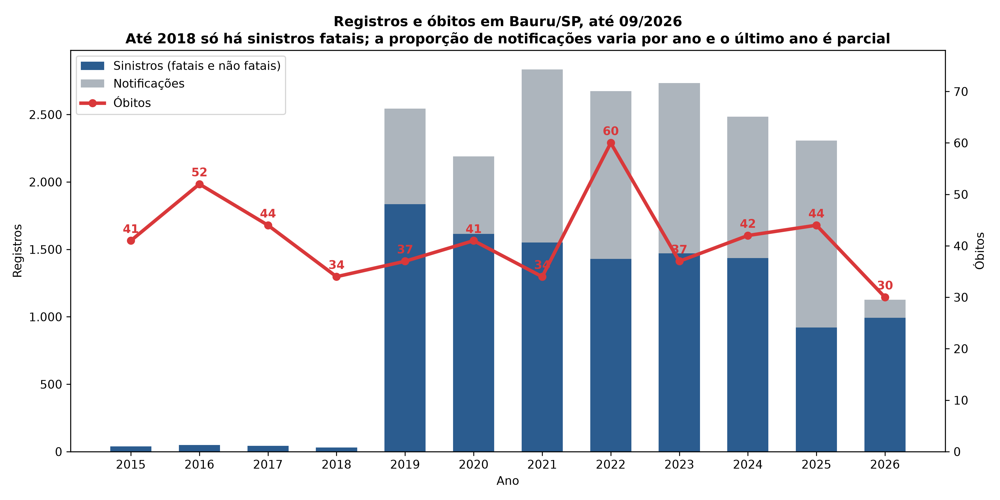
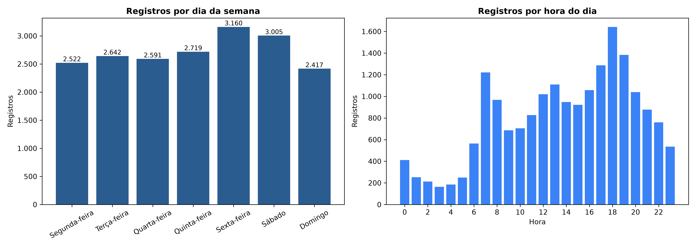
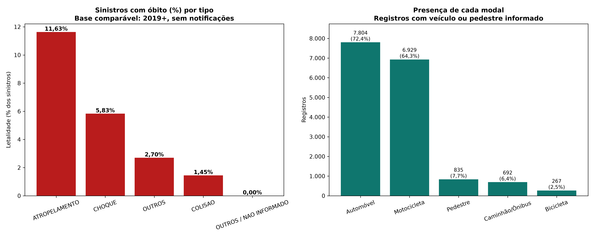
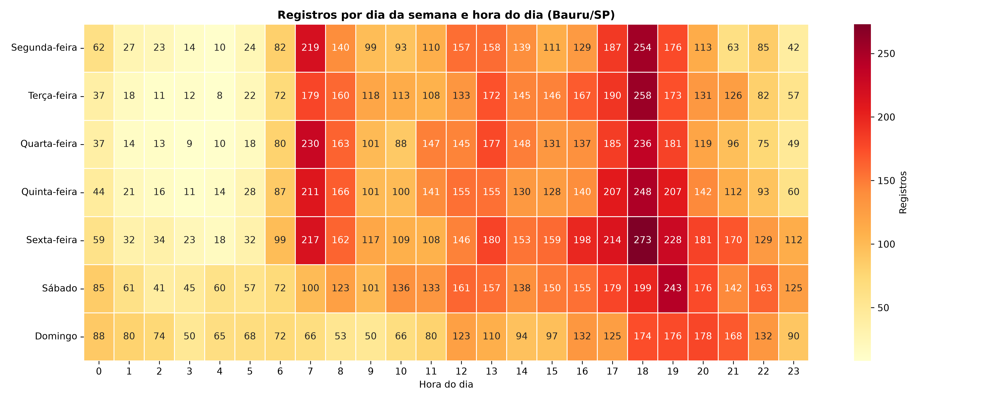
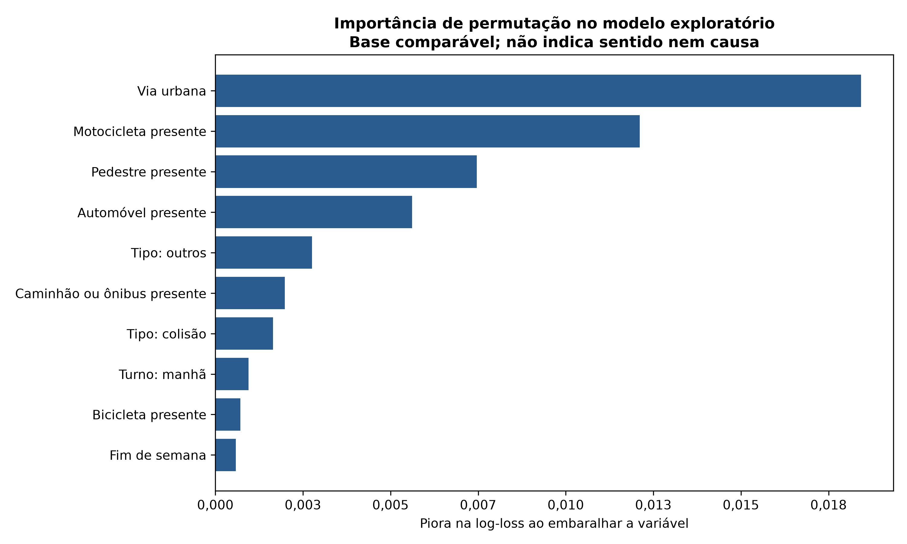

<!-- Gerado por scripts/gerar_artefatos.py. Para mudar o texto, edite templates/README.md.j2. -->
# 🚦 Análise de Sinistros de Trânsito em Bauru/SP

[](https://www.python.org/)
[](https://pandas.pydata.org/)
[](https://scikit-learn.org/)
[](https://plotly.com/)

Estudo de Ciência de Dados sobre os registros de trânsito de **Bauru/SP** no Infosiga SP, com ingestão de dados estaduais, análise estatística, modelo exploratório de gravidade, mapa interativo e painel em Streamlit.

Os números abaixo usam os dados de 13/01/2015 a 30/09/2026. O [relatório técnico](output/relatorios/relatorio_final_bauru.md) traz a análise completa. As correções ao estudo de 30/09/2026 estão na [errata](output/relatorios/ERRATA.md).

> **Atualização automática:** este README, o relatório, os gráficos e o mapa são gerados de novo quando chegam dados mensais. Gráficos e mapa ficam na branch [`artefatos`](https://github.com/douglasagalbiatti/projeto-transito-bauru/tree/artefatos), que guarda apenas a versão mais recente. O `relatorio_bauru.pdf` é um registro histórico e mantém o texto de 30/09/2026.

---

## 📌 Principais resultados

- **Base:** 19.056 registros (`cod_ibge == 3506003`), dos quais 7.645 são notificações (40,1%). Há 496 óbitos, 1.147 feridos graves e 10.745 feridos leves.
- **Dados de vítimas:** 43,5% dos registros não informam vítimas, o que não significa que ninguém se feriu.
- **Letalidade:** atropelamentos têm 11,63% de sinistros com óbito, choques 5,83% e colisões 1,45%. A diferença entre choque e colisão é urbana: 5,9 vezes nas vias urbanas e 0,9 nas rodovias.
- **Vias:** as vias urbanas têm 53% dos óbitos, e estradas e rodovias, 40%. A letalidade por sinistro é maior nas rodovias (6,5%, contra 1,9%). SP-300, SP-225 e SP-294 somam 35% dos óbitos.
- **Dias:** a média é de 6,70 registros/dia em dias úteis e 6,63 em fins de semana (p = 0,634). Isso não prova igualdade, e sexta (7,75) e sábado (7,35) ficam acima dos demais dias.
- **Modais:** entre registros com modal informado, há automóvel em 72,4% e motocicleta em 64,3%. A base não liga cada vítima ao seu veículo nem traz frota, então não mede o risco de cada modal.
- **Modelo:** a acurácia de 88,4% é praticamente a de sempre prever a classe mais comum (88,2%), com ROC-AUC de 0,683. O modelo é exploratório e não prevê acidentes.

### Comparabilidade

De 2015 a 2018, só há sinistros fatais. A partir de 2019, entram sinistros não fatais e notificações, que vão de 11,8% a 60,1% dos registros por ano. Por isso, o total anual não mede tendência. Letalidade, perfis de gravidade e modelo usam a **base comparável**: sinistros de 2019 em diante, sem notificações.

### Limitações

A base não traz fluxo de veículos, frota, velocidade, alcoolemia nem o objeto atingido em choques. Volumes não medem risco, e as recomendações são hipóteses a validar em campo.

---

## 📊 Visualizações











O [mapa interativo](https://github.com/douglasagalbiatti/projeto-transito-bauru/blob/artefatos/output/graficos/mapa_acidentes.html) pode ser baixado em HTML ou aberto no painel.

---

## 📂 Estrutura do Projeto

```text
projeto_transito_bauru/
├── app.py                               # Painel em Streamlit
├── data/
│   ├── bauru_limpo.csv                  # Base tratada, versionada
│   └── sinistros_*.csv                  # Arquivos brutos do Infosiga, fora do Git
├── notebooks/                           # Exploração, limpeza, análise e mapa
├── output/
│   ├── graficos/                        # Figuras PNG e mapa HTML (na branch artefatos)
│   └── relatorios/
│       ├── relatorio_final_bauru.md     # Relatório técnico atual
│       ├── resumo_anual_bauru.csv       # Tabela anual
│       ├── relatorio_bauru.pdf          # Estudo de 30/09/2026 (histórico)
│       └── ERRATA.md                    # Correções ao estudo de 30/09/2026
├── scripts/
│   ├── atualizar_dados_infosiga.py      # Atualização incremental pela API do Infosiga
│   ├── gerar_artefatos.py               # Gráficos, mapa, relatório e README a partir da base
│   ├── publicar_artefatos.sh            # Substitui a branch artefatos
│   ├── process_bauru_pipeline.py        # Reconstrução a partir dos arquivos brutos
│   └── create_notebooks.py              # Gerador dos notebooks
├── src/
│   ├── indicadores.py                   # Números e conclusões dos documentos
│   ├── metricas.py                      # Regras estatísticas compartilhadas
│   └── modelo.py                        # Modelo exploratório
├── templates/                           # Modelo do README
└── tests/
```

---

## 🛠️ Como Reproduzir

```bash
python3 -m venv .venv
```

```bash
source .venv/bin/activate
```

```bash
pip install -r requirements.txt
```

Atualizar a base com os meses novos, reprocessando os três mais recentes para incorporar revisões da fonte:

```bash
python scripts/atualizar_dados_infosiga.py --automatico
```

Regenerar gráficos, mapa, relatório e README. A atualização mensal automática já faz isso; altere os textos do README em `templates/README.md.j2` e os do relatório em `scripts/gerar_artefatos.py`, pois os arquivos gerados são sobrescritos:

```bash
python scripts/gerar_artefatos.py
```

Abrir o painel:

```bash
streamlit run app.py
```

Rodar os testes:

```bash
python -m unittest discover -s tests -t .
```

Para reconstruir a base do zero, coloque os arquivos brutos em `data/sinistros_*.csv` e execute `python scripts/process_bauru_pipeline.py`.
